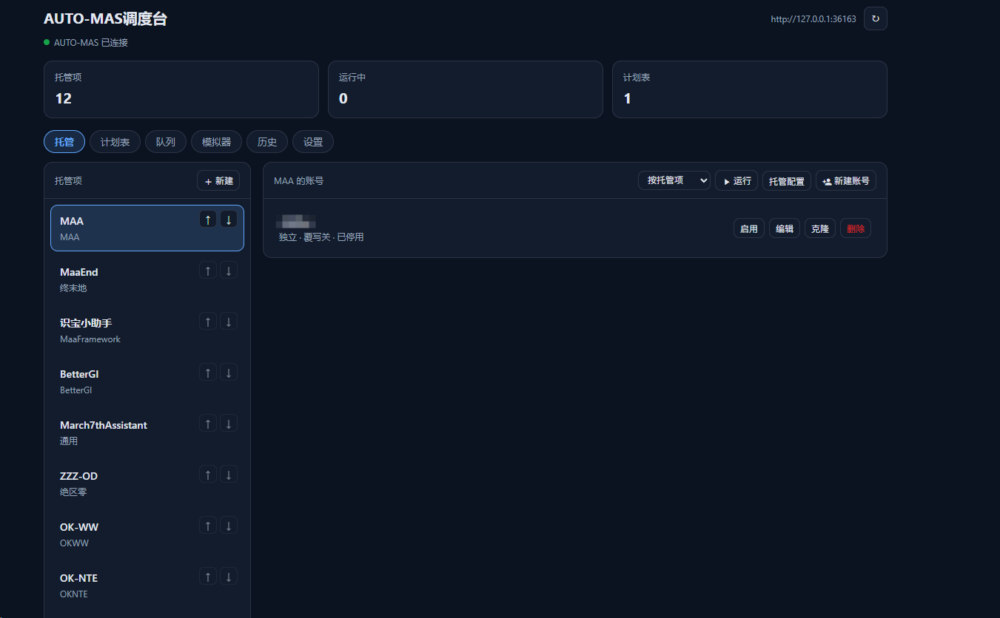
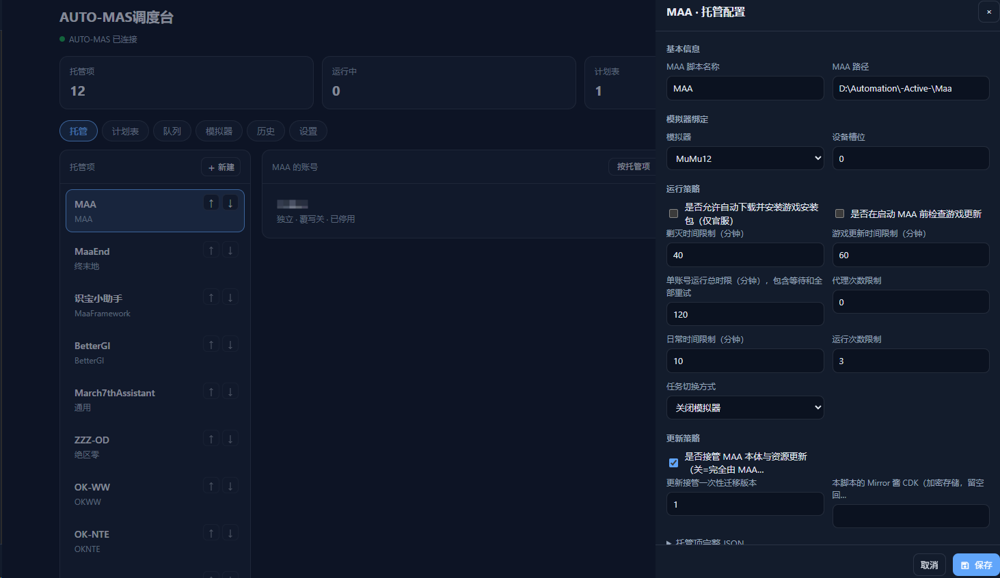
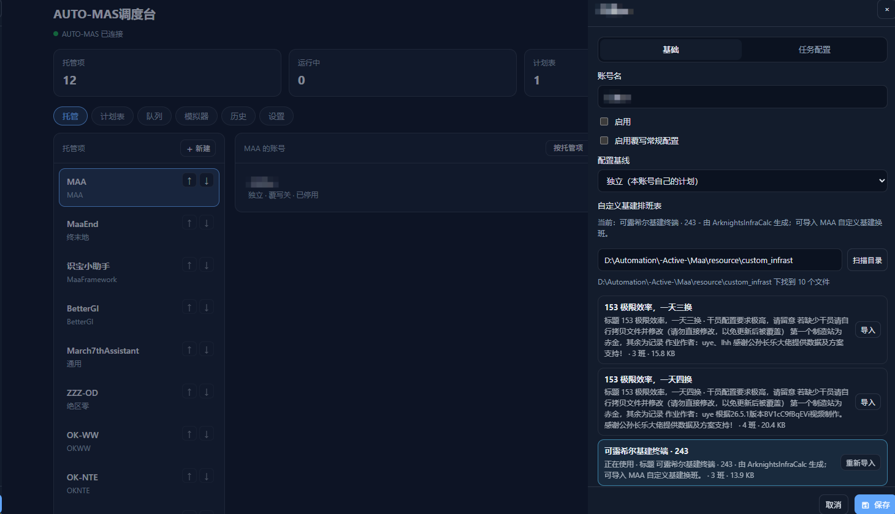
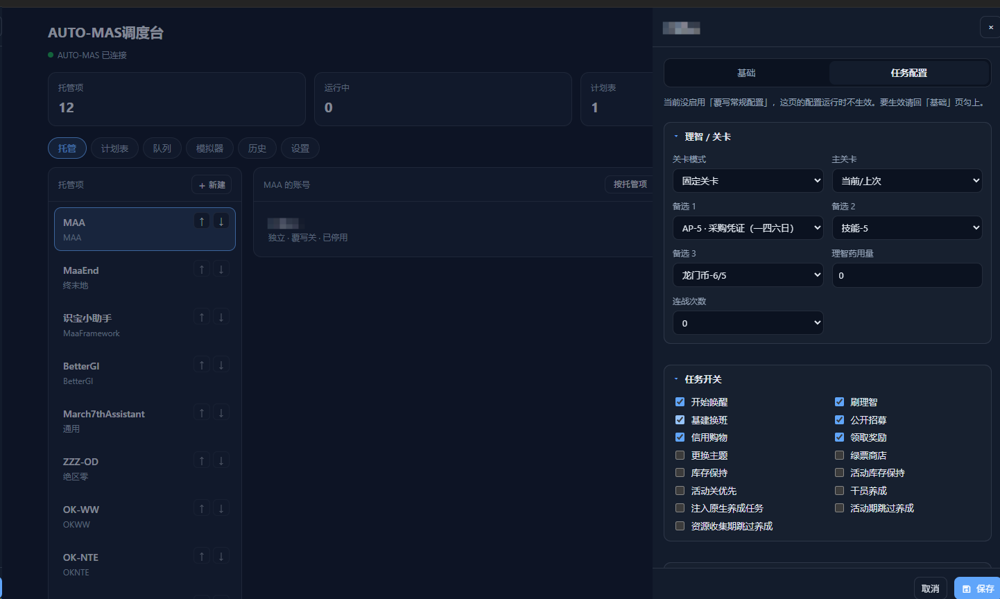

# astrbot_plugin_automas_connect

把 [AUTO-MAS](https://github.com/AUTO-MAS-Project/AUTO-MAS) 接进 AstrBot：QQ 指令 + 一个「轻量版 MAS 面板」，托管的日常操作不用切回桌面端。

> 本插件由 大肥鱼🐟 制作（哼哼本鱼厉不厉害）。正在快速迭代，欢迎提交 Bug、使用建议和改进意见。
>
>（我去什么时候MAS适配大部分脚本了，没做这插件估计还在用通用配置。按理来说应该没问题吧...（呆货主人））


## 目录结构

```
astrbot_plugin_automas_connect/
├─ main.py              /mas 指令 + 任务卡死兜底
├─ mas_api.py           AUTO-MAS HTTP 客户端（所有接口调用都在这里）
├─ webui.py             Plugin Pages 后端路由（50+ 条 /api/plugin/...）
├─ _conf_schema.json    AstrBot 插件配置：后端地址、超时、10 个功能开关
├─ metadata.yaml
├─ CHANGELOG.md         版本说明（和 Releases 同步）
├─ requirements.txt     httpx（AstrBot 自带）
├─ logo.png
├─ pages/console/       面板前端：index.html / app.js / style.css
│  └─ vendor/mdi/      自托管的 Material Design 图标字体（不走 CDN）
├─ tools/
│  └─ gen_config_schema.py   从 AUTO-MAS 源码抽字段 schema 注入 app.js
├─ _schema.json         生成脚本的中间产物（升级 AUTO-MAS 后重跑时用）
└─ docs/screenshots/    README 里的展示图
```
## 装之前

- 把整个插件目录放进 `AstrBot/data/plugins/astrbot_plugin_automas_connect/`，然后重启 AstrBot（或重载插件）。依赖只有 `httpx`，AstrBot 自带，一般不用另装。
- AUTO-MAS 后端得开着（正式版默认 `http://127.0.0.1:36163`，源码调试版是 36164）。
- AUTO-MAS 的接口没有鉴权，只适合本机或可信内网，别把端口暴露到公网。
- 插件用 `trust_env=False` 发请求，本机地址不会被系统代理接走。
- 装好后必须在 `AstrBot/data/cmd_config.json` 的 `plugin_set` 白名单里加上插件名，否则 AstrBot 压根不会加载它（该文件带 BOM，读写用 utf-8-sig）。
- 改了 Python 代码要重载插件；只改 `pages/` 下的静态文件刷新页面即可。

## 配置

| 键 | 说明 | 默认 |
| --- | --- | --- |
| `mas_base_url` | AUTO-MAS 后端地址 | `http://127.0.0.1:36163` |
| `request_timeout` | 接口超时（秒） | 15 |
| `require_admin` | 只有管理员能用 `/mas` 指令 | true |
| `notify_umo` | 异常通知发到哪个会话（umo） | 空 |
| `auto_restart_seconds` | 任务异常结束后等多少秒自动重启，0 = 关 | 0 |

### 功能开关

`features` 分组下 10 个开关，默认全开。关掉哪项，面板里对应入口和指令一起消失：

| 键 | 管什么 |
| --- | --- |
| `accounts` | 账号管理（新建 / 编辑 / 克隆 / 删除） |
| `task_config` | 任务配置页（理管关卡、任务开关、剿灭基建） |
| `plans` | 计划表视图 |
| `queue` | 调度队列与定时视图 |
| `scheduler` | 调度中心视图（运行范围、实时状态、日志、电源操作） |
| `scripts` | 托管项管理（新建 / 编辑 / 排序 / 运行 / 删除） |
| `emulator` | 模拟器视图（开关机、槽位状态） |
| `history` | 运行历史视图 |
| `settings` | 全局设置与通知渠道 |
| `qq_command` | `/mas` 指令 |

## 指令

```
/mas 状态                          看现在跑着什么
/mas 托管                          列出所有脚本托管项
/mas 账号 MAA日常                  列出该托管下的账号
/mas 启动 MAA日常 大号,小号         启动（不带账号=全部）
/mas 停止 [任务ID]                  停止，不带 ID 停全部
/mas 计划                          列出计划表
```

## 面板

AstrBot 后台 → 插件 → AUTO-MAS调度台 → 打开页面。顶部一排视图标签：

| 托管项视图 | 托管项配置（独立抽屉） |
| --- | --- |
|  |  |

| 账号基础页（自定义基建排班表） | 任务配置页 |
| --- | --- |
|  |  |

### 托管项

- 左侧列表每条右侧有常显的 ↑ ↓ 按钮，点了直接写回 AUTO-MAS 的顺序；「+ 新建」支持 14 种类型（MAA / MaaEnd / M9A / MaaFW / HSR / BetterGI / ZzzOd / BAAH / Whimbox / MSS / Okww / OkNte / SRC / General），还能选一个现有托管项当模板复制（连账号一起复制）。
- 「运行」可选四种模式：按托管项（AutoProxy）、按脚本配置（ScriptConfig）、仅更新（Update）、循环运行（CycleRun）。
- 正在跑的任务显示在页面顶部一条通栏状态条里（哪个托管项、什么模式、一键停止），不跟选中的托管项绑在一起；对应托管项在左边列表里也会挂一个「运行中」角标。
- 托管项配置是**单独一个抽屉**（右上「托管配置」按钮进，跟账号编辑完全分开）：编 Path、绑定的模拟器与槽位、运行策略（各时限、重试次数、更新处理），另有完整 JSON 兜底。
- 删除托管项会连带删掉它下面的账号，按钮会二次确认。
- 抽屉里有没保存的改动时，点空白 / 按 ESC 关掉会问一句，三选：取消、不保存、保存（选保存就直接写回 AUTO-MAS，写失败不关抽屉）。
- 点遮罩关抽屉要「按下和松开都在空白处」才算数：从抽屉里按住往外拖选文字，手滑到空白处再松开不会把抽屉关掉。

### 账号（托管项下）

新建（空白默认配置 + 起名）、编辑、克隆、删除；列表每行还有「停用 / 启用」按钮，点一下直接改 `Info.Status`，不用进抽屉。

编辑抽屉分两页（托管项配置已经拆成独立抽屉，不在这里）：

- **基础**：账号名、启用、覆写常规配置、配置基线（共享 / 独立 / 原生），下面紧跟**自定义基建排班表**，最后是完整配置 JSON（兜底）；
  - 排班表：打开账号自动扫一遍 MAA 目录下的 `resource/custom_infrast`（目录可手改），列出每份 `*.json` 的标题、说明、班次数和大小，点「导入」直接调 AUTO-MAS 自己的 `scripts/user/infrastructure` 写进账号，正在用的那份会标出来；
  - 排班表原文（`Data.CustomInfrast`）在 AUTO-MAS 里是隐藏字段，账号配置读回来时不带它，所以这里只能看服务端解析好的名字（`Task.InfrastName`），改排班表就是重新导一份；
- **任务配置**：理智关卡（主关 + 3 个备选、理智药、连战次数）、15 个任务开关、剿灭与基建（剿灭任务 / 开始日 / 基建模式 / 活动关序号与理智药），下方三块可视化编辑器：
  - 库存保持计划：每行 = 关卡（下拉）+ 材料（`scripts/maa/depot/items` 拿到的 DropId 列表）+ 保底数量，可增删行；
  - 活动库存保持：`all`（全活动关预设数量 / 合成玉数量）或指定活动关（关序号 / 本身数量 / 合成玉数量 / 跳过），活动池来自 `info/get/overview` 的 Activity 段，没有活动时序号退化成数字输入；
  - 养成目标：选干员（`scripts/maa/cultivate/operators` 目录）→ 加目标（精英化 / 技能 / 专精 / 模组 + 档位），专精和模组再选具体技能或模组；
  这三块仍然写回 `Task.DepotMaintainPlans` / `Task.EventDepotMaintainPlans` / `Task.CultivateTargets` 三个 JSON 数组字段。关卡候选一部分来自 AUTO-MAS 的 `info/get/overview`（只给当前开放的可刷资源关），本地还带一份 18 项的兜底表；
- **托管配置**：不在这个抽屉里了，点账号列表上方的「托管配置」按钮打开独立抽屉。

任务配置只有在勾了「启用覆写常规配置」时才生效，没勾时页面会提示。

上面这套手工表单只对 **MAA（MaaConfig）** 托管项的账号配置生效（它的任务参数有语义，值得单独排）。

**MaaEnd（MaaEndConfig）** 的任务配置也做了专门处理：采集模式（分散 / 集中）、采集路线（按地区分组、可多选）、基质养成（随机 / 地区 / 目标模式 + 指定地区 + 指定武器，按武器种类分组）、危境预演档位、理智任务类型、奖励组、运送委托来源等，全部是中文下拉或芯片多选；「每日只做一次的任务」直接列出 MaaEnd 自带的中文任务名给你勾。这些候选来自 AUTO-MAS 的 `scripts/maaend/options` 接口和 MaaEnd 自己的 `locales/interface/zh_cn.json`，不写死。

另外两块原本只能改 JSON 的字段也接上了：「培养道具目标」（`Task.SupplyPlanLimits`，上游叫库存目标）现在是一张 16 行的表格，折金票 / 协议棱柱 / 作战记录经验 / 强固模具 / 象限拟合液……每行填目标数量，填 0 或留空就是不纳入规划；「库存任务领取方式」（`Task.ProtocolSpaceObtainModeClaim`）是「单倍领取 / 优先双倍领取」的下拉。改动仍然只提交你碰过的那一项，字符串形态的 JSON 会原样保持。

**OK-WW（鸣潮）**：字段名是英文、说明又长，页面上换成 MAS 界面的叫法——「消耗体力刷取」（无音区 / 凝素领域 / 模拟领域）、「刷什么材料」（贝币 / 角色经验 / 武器经验）、两个「F2 列表里第几个」序号、「需要时用梦魇巢穴完成日常声骸」、「每日任务后运行的附加任务」（芯片多选）。值仍按上游要求存英文。

**OK-NTE（异环）**：它的具体任务参数不在账号配置里（`Task` 只有 `TaskIndex` / `ExitOnFinish` 两个键），而在 ok-nte 自己目录下的 7 份 json 里，所以任务页改成一整套配置编辑器：

- 顶部「启动任务与结束行为」= `TaskIndex`（从 19 个 ok-nte 任务里选）+ `ExitOnFinish`，并显示拼出来的启动参数（`-t N -e`）；
- 「日常任务流程」= 8 个子任务勾选 + ↑↓ 排序，「异象界域 / 异象追猎」互斥，开一个自动关另一个；
- 「日常子任务配置」= 每个子任务的参数（目标消耗体力、任务类型、具体奖励目标、各类材料序号、循环模式与序列、咖啡店 / 签到 / 约会等），按上游字段类型出数字框 / 下拉 / 开关 / 芯片；
- 「触发配置 / 全局配置」= 自动战斗触发、游戏快捷键、小月卡、声音触发、基本设置。

 字段和候选都由 AUTO-MAS 的 `scripts/oknte/configs/list` 下发（`scripts/oknte/configs/batch-update` 写回），改哪份文件就只提交哪份；上游加新字段会自动出现，不用改插件。

**BetterGI / ZZZ-OD（一条龙编排）**：任务配置里多出两条「一条龙」编排块。BetterGI 列出当前要跑的组（顺序就是执行顺序，可加、删、上移下移、一键套用默认 8 组），下面是自定义配置组（名字 + 启用）。ZZZ-OD 列出当前编排的任务（中文名 + 启用勾选 + 上移下移移除），再下面是还没加入的任务候选（点一下加到最后，可调参数的任务带「可调参数」标签），最下面选跑完之后做什么（无 / 关闭游戏 / 关机）。它的任务页里「游戏 / 一条龙」这些分组默认都是收起的，点标题展开。展开之后加一条任务、改一个数字都只刷新内容，折叠块不会自己收回去；重新打开账号或切回任务页才回到默认收起的初始状态。候选和中文名来自 AUTO-MAS 自己的 scripts/zzzod/catalog 和 scripts/bettergi/one-dragon/custom-groups，不写死。

**MaaFW（识宝小助手这类 MaaFramework 项目）**：账号配置里其实只有 `Task.SelectedPreset` 和 `Task.TaskSnapshot`，真正的编排全在后者那串 JSON 里（`taskOrder` / `taskChecked` / `taskOptions`）。插件会去读脚本目录下的 `interface.json`（含它 import 的子文件），把任务、选项、官方预设解析成「任务清单 + 每个任务可展开的选项」：勾选 = 这次要跑，↑↓ 调顺序，选项按上游类型自动出开关 / 下拉 / 输入框；预设那一栏可以一键套用「日常-简化版 / 完整版 / 建议单独运行」。任务名和选项名都来自脚本自己的 interface，换一个 MaaFramework 项目也不用改代码。改动只写回 `TaskSnapshot`（和 `SelectedPreset`），其它字段不动。
**M9A / MSS 同款编排**：这两个也是 MaaFramework 项目，账号配置结构和 MaaFW 一模一样（`Task.SelectedPreset` + `Task.TaskSnapshot`），所以直接复用上面那套任务编排界面；换项目只要脚本目录里有 `interface.json` 就行，任务名、选项、预设都从界面定义文件读。

**HSR / SRC（星穹铁道两条线）**：任务页按 schema 出控件，全部中文——HSR 的体力关卡通道（金花 / 赤花 / 遗器 / 位面饰品）、历战余响从周几开始刷、四个模块开关（货币战争 / 日常 / 差分宇宙 / 领取奖励）都是下拉和勾选；SRC 的关卡是上游的长英文代码（`Calyx_Crimson_...`、`Cavern_of_Corrosion_...`），插件把前缀翻成中文（金花·回忆 / 赤花·xxx / 侵蚀隧洞·xxx 之径 / 凝滞之影·xxx / 模拟宇宙·世界 N），后面的专名保留原文，存回去仍是英文代码。HSR 的 `Managed.Options` / `TaskMapping`、SRC 的 `ScriptStage` 是自由 JSON，留多行框编辑。

**BAAH**：它的任务内容写在自己的配置文件里，账号配置没有 Stage / Task 段，只有 `Info` 下四项策略，插件把它们单独拎成「BAAH 活动与关卡策略」：活动按哪个服排（日服 / 国际服 / 国服）、活动关是否优先、关卡计划表（Fixed = 按脚本配置）、配置文件名。

**配置基线是「原生」时，任务配置页整块隐藏**：这会儿 AUTO-MAS 只负责把脚本拉起来，做什么由脚本自己的配置决定，所以插件不展示任务勾选，只提示先去「基础」页把基线改成「独立」或「共享」并勾上「启用覆写常规配置」。

任务配置页的分组都做成了可折叠的二级面板（默认只展开第一组），不会一屏堆到底。
组内的超长字段（6 项以上的芯片多选、大段 JSON 串）自己再收一层：平时只显示标题和「已选 N / 共 M 项」，点开才铺开改，像 MaaEnd 的采集路线和「每日只做一次的任务」那种几十个勾的就不会把页面撑长。
**Whimbox（奇想盒）**：任务页按上游任务目录（`scripts/whimbox/task-catalog`）渲染——上面是步骤开关列表（勾上 = 让这条步骤跑，取消 = 显式关掉，关掉的行会划掉），下面按上游声明的字段类型出参数控件（开关 / 下拉 / 数字 / 芯片多选 / 文本）；每行右侧「默认」按钮把那项覆盖删掉、回到上游默认值。

**General（通用脚本）**：这类脚本没有任务段（做什么由它自己决定），任务页只放运行策略——任务前后要不要先跑一段批处理（路径可填）、账号剩余天数提醒，真正的任务参数在脚本自己的界面里配。

其余类型的账号配置、以及托管项的「托管配置」、模拟器的配置，都走**按 AUTO-MAS 源码 schema 生成的表单**：字段类型、取值范围、枚举候选、说明文字全部从 AUTO-MAS 的配置模型里抽出来，布尔出勾选框、枚举出下拉、数字带上下限、数组出芯片多选、长文本和 JSON 串出多行框（填错标红不写回），改了哪项提交哪项，最后走整份保存。字段名统一显示中文。

settings 那页也一样：8 组设置项按 schema 出控件，枚举值不会写错。

### 字段 schema 从哪来

`pages/console/app.js` 顶部四行常量（`CONFIG_SCHEMA` / `SCRIPT_SCHEMA` / `EMULATOR_SCHEMA` / `SETTING_SCHEMA`）是生成出来的，别手改：

```
python tools/gen_config_schema.py --source "Y:\AUTO-MAS\repo\app\models\config\script.py"
```

脚本会解析 AUTO-MAS 源码里的 Pydantic 模型（`script.py` + 同目录的 `emulator.py`、`setting.py`），把每个字段的 label / 类型 / 候选值 / 说明 / 嵌套结构导出成 JSON，注入 app.js。AUTO-MAS 升级后重跑一次就同步。

- 源码路径要指到 108 上 AUTO-MAS 的 **`repo\app\models\config\script.py`**（`repo\` 才是带源码的仓库目录，`app\` 是编译产物）。
- 源码里没写 `description` 的字段没有中文名，靠 app.js 里的 `SCRIPT_KEY_LABELS`（103 条）和按组覆盖的 `GROUP_KEY_LABELS` 兜底；`_uicheck/scriptform.mjs` 会检查每种类型有没有裸英文漏出来。

### 调度中心

把 AUTO-MAS 的「调度中心」搬了过来，页面开着时每 3 秒拉一次运行快照（走 HTTP，不用接 WebSocket）：

- 左上「运行来源」是**一个下拉**，跟 AUTO-MAS 一样把队列和脚本混在一起列：`队列 - 日常`、`队列 - 临时`、`脚本 - MAA - MAA`……选队列就按队列里排好的顺序连着跑一串脚本（模式只有自动代理 / 循环运行两样），选脚本就只跑那一个（四种模式：自动代理 / 循环运行 / 按脚本配置 / 仅更新）；切换过的来源会缓存账号列表，切回来不用再等，后端也是一次并发把队列里各脚本的账号拉齐；
- 队列模式下会多一个「从指定托管继续」下拉，选了就从那一项开始跑，排在它前面的会被 AUTO-MAS 标成跳过；
- 下面勾**本次运行范围**：队列模式按脚本分组列出这个队列会碰到的所有账号（AUTO-MAS 的 `queueUserIds`），只勾这次要跑的，停用的账号置灰不能勾；某个脚本一个都不勾就等于这次跳过它；「全选 / 取消全选」一键切；
- 右侧按任务列出每个脚本和它的账号状态（等待 / 运行中 / 跳过 / 失败 / 完成），循环运行的任务还会列出下一轮待跑项和到点时间；每个任务能单独停止、展开看实时日志尾部；
- 左下「任务完成后电源操作」：关机 / 强制关机 / 重启 / 休眠 / 睡眠 / 退出 AUTO-MAS / 重启 AUTO-MAS / 注销，选了就写进 AUTO-MAS（跑完才执行）；真有倒计时时显示剩余秒数，可以「取消倒计时」拦下来。
- 右下「已启用定时」列出开着定时队列的托管项。

### 计划表

表格编辑：行是全局默认 + 周一到周日 + 第 N 天（按轮换天数），列是关卡、3 个备选、连战、理智药。支持新建（MaaPlan / MaaEndPlan）、删除、整份保存。

### 调度队列

左列表选队列，「+ 新建」建队列；右侧编队列名、启动模式、完成动作、前后置脚本，下面是任务项和定时项：

- 任务项：选脚本、固定时间 / 间隔模式、时间或间隔分钟、起点（开始/结束）、星期、启用，可上下移和删除；
- 定时项：时间、星期、启用、删除。
- **改动即落库**（单项部分更新），没有批量保存；「保存」按钮只提交队列本身的设置。
- 时间显示按本机时区换算（AUTO-MAS 存的是 UTC）。

### 运行历史

选日期区间和粒度（按天 / 按周 / 按月），左边出日期列表，右边按账号分组列每次运行的时间、状态、结果，点「看日志」展开该次运行的日志尾巴（最多 2 万字符）。

### 模拟器

列表显示每个模拟器的槽位数和在线数；点进去能看每个槽位的状态和 adb 地址，并直接开机 / 关机 / 唤出。其余配置走分组表单 + 完整 JSON。

### 设置

左边 8 组（显示 / 功能 / 通知 / 录像 / 启动 / 界面 / 更新 / 语音）外加「通知渠道」。改一项即时提交单项，不会覆盖其它字段。`Replay.Password` 只读不写（接口返回的是掩码，写回去会把密码改坏）。

通知渠道列表能新建、编辑（名称 / 启用 / 方法 / URL / Headers / Template）、测试、删除，模板就是标准 OneBot v11 数组，可以直接打 NapCat。

## 常见问题

**面板一直显示「正在连接」**
先确认 AUTO-MAS 开着，端口和配置里的 `mas_base_url` 一致（正式版 36163，源码调试版 36164）。浏览器直接打开 `http://<地址>:36163/api/health`，能看到返回就说明后端没问题。跨机时地址换成 `192.168.x.x`，并确认防火墙放行。

**AstrBot 插件列表里根本找不到它**
`data/cmd_config.json` 里的 `plugin_set` 是显式白名单，没加插件名就不会加载。该文件带 BOM（读写用 utf-8-sig），加完要完整重启 AstrBot，只重载插件不生效。

**改了代码没反应**
Python 改动要重载插件；只改 `pages/` 下的静态文件，浏览器 Ctrl+F5 硬刷新就够（面板有静态缓存）。

**任务配置页是空的 / 让我去 JSON 里改**
两种可能：这个账号的配置基线是「原生」（干什么由脚本自己决定，插件故意不展示任务配置），或者没勾「启用覆写常规配置」。另外只有 MAA 类型有手工表单，其它类型走按 schema 自动生成的表单。

**有些字段名还是英文**
AUTO-MAS 源码里没写 `description` 的字段就没有中文说明，靠插件里的映射表兜底。重跑 `tools/gen_config_schema.py`，或往 `SCRIPT_KEY_LABELS` 里补一条。

**保存报 422**
多半是某个 JSON 串字段填了非法 JSON（页面对应输入框会标红）。改完再存。

## 已知限制

- **克隆账号会连带复制账号名、用户目录、模拟器 slot**，克隆完记得改掉，否则两个账号会抢同一个模拟器实例。
- AUTO-MAS 自己会做失败重试和卡死检测，本插件的 `auto_restart_seconds` 只是重试耗尽后的兜底，默认关闭，暂未在真实任务下验证。
- 计划表的字段以接口实际返回为准（运行版本比源码新，多出 Day1..Day31 等键），不做字段裁剪。
- 自定义基建排班表只能整份导入替换，不能逐班编辑（AUTO-MAS 就是这么设计的，排班表原文不下发）。
- 字段中文名有两层来源：AUTO-MAS schema 里自带的中文说明最优先，没有的走插件里的映射表兜底；AUTO-MAS 加了新字段而映射表没跟上时，会显示成英文 key，补一条映射或重跑 `gen_config_schema.py` 即可。
- 未做：睡眠/唤醒电源控制、自更新、扫码登录、社区签到工具。

## 开发与测试

- `_uicheck/` 是一套 jsdom 冒烟测试（放在插件目录外，不进部署），用真实 DOM 跑 `app.js`，覆盖各视图渲染、抽屉交互、每种脚本类型的任务配置。`node run_all.mjs` 一次全跑，目前 24 套 468 项。
- 后端接口都注册在 `webui.py` 的 `_register_routes` 里。**响应体里别用 `data` 当键**：AstrBot 插件页的 bridge 遇到 `data` 只把它的值交给页面，详情类接口统一用 `config`。
- 字段 schema 用 `tools/gen_config_schema.py` 从 AUTO-MAS 源码重新生成，别手改 `app.js` 顶部那几个常量。

## 更新日志

每个版本改了什么写在 [CHANGELOG.md](CHANGELOG.md)，和 Releases 的说明一致。

## 致谢

感谢各位脚本开发者，省了很多日常/周常的时间🙏

- [AUTO-MAS](https://github.com/AUTO-MAS-Project/AUTO-MAS) : 自动化脚本类软件的管理工具，助我更好地猛嗦小脚
- [AstrBot](https://github.com/AstrBotDevs/AstrBot): 可靠的聊天机器人，助我更好地猛嗦小脚
- [MaaAssistantArknights](https://github.com/MaaAssistantArknights/MaaAssistantArknights): 明日方舟自动化脚本，助我更好地猛嗦铃兰小脚
- [MaaEnd](https://github.com/MaaEnd/MaaEnd): 明日方舟：终末地自动化脚本，助我更好地猛嗦洛茜小脚
- [Maa_bbb](https://github.com/miaojiuqing/Maa_bbb): 崩坏三自动化脚本，助我更好地猛嗦希儿小脚
- [better-genshin-impact](https://github.com/babalae/better-genshin-impact): 原神自动化脚本，助我更好地猛嗦芙芙小脚
- [March7thAssistant](https://github.com/moesnow/March7thAssistant): 崩坏：星穹铁道自动化脚本，助我更好地猛嗦希儿小脚
- [ZenlessZoneZero-OneDragon](https://github.com/OneDragon-Anything/ZenlessZoneZero-OneDragon): 绝区零自动化脚本，助我更好地猛嗦诺姆小脚
- [ok-wuthering-waves](https://github.com/ok-oldking/ok-wuthering-waves): 鸣潮自动化脚本，助我更好地猛嗦尤诺小脚
- [ok-nte](https://github.com/BnanZ0/ok-nte): 异环自动化脚本，助我更好地猛嗦安魂曲小脚
- [Mirror酱](https://github.com/MirrorChyan/user-frontend): 第三方应用分发平台，自动化脚本，助我更好地猛嗦小脚